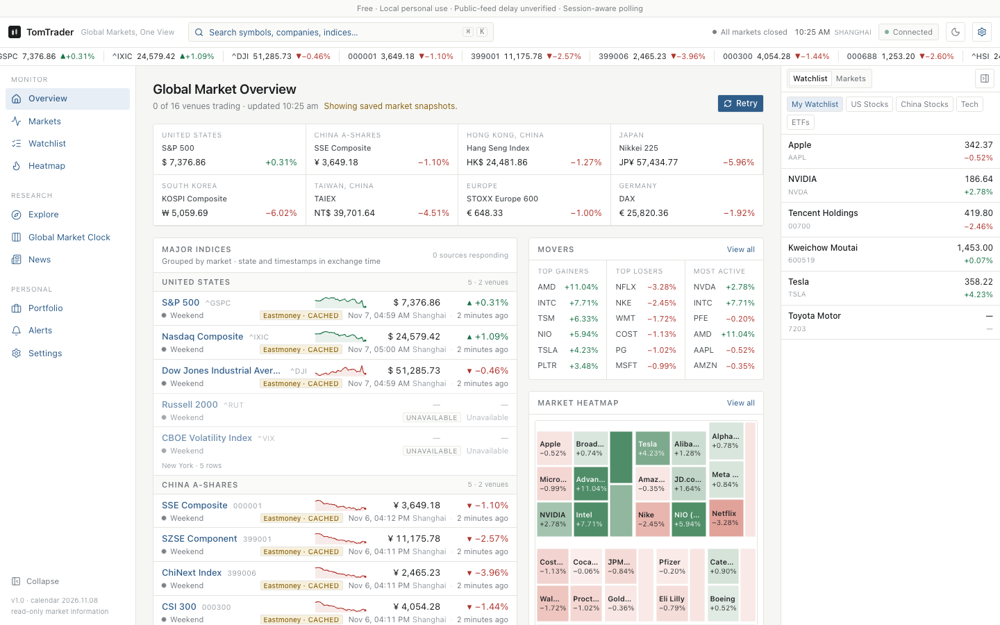
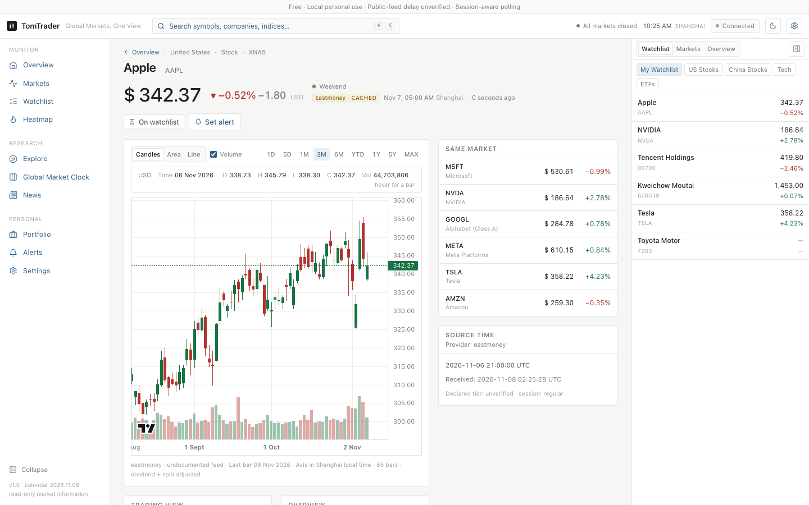
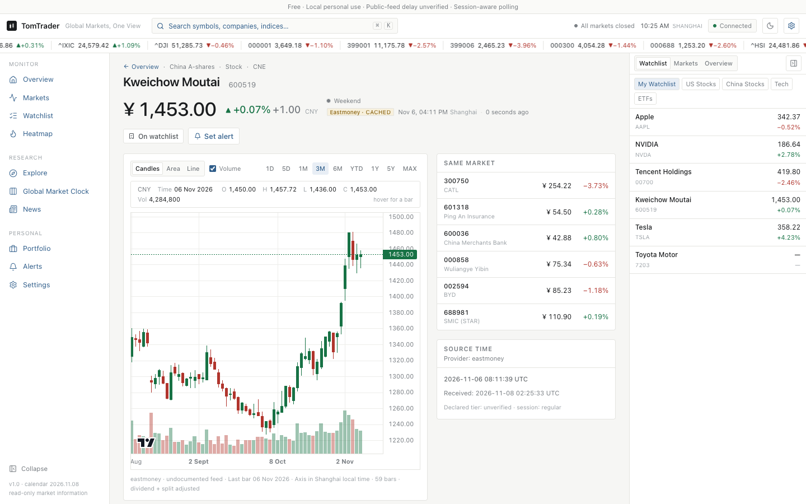
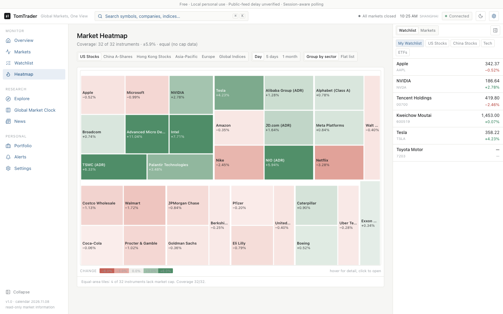
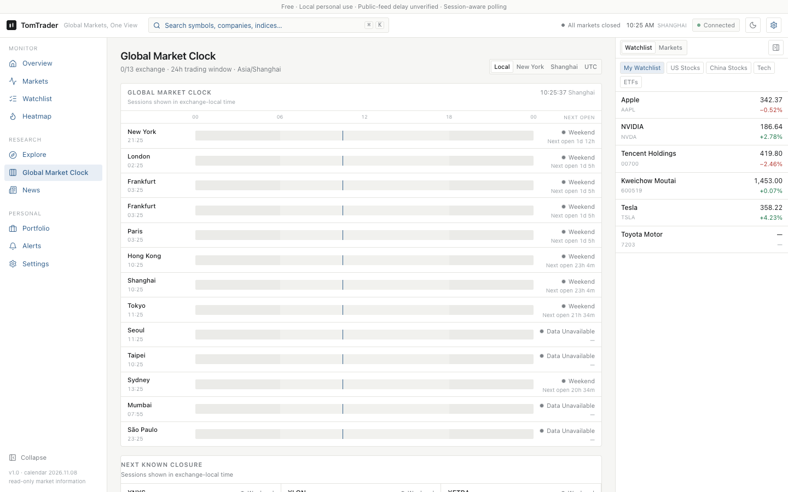

# TomTrader

**Global Markets, One View.** A local-first global market terminal that runs entirely on your own machine — it does **not** connect to any broker and does **not** execute trades. It watches the world for you: A-shares, Hong Kong, US stocks & ETFs, global indices, commodities and FX, in one bilingual (中文 / English) interface.

> 本地运行的全球市场观察终端：A 股、港股、美股与 ETF、全球指数、商品与汇率，一个界面看全球。不连接券商、不执行交易。默认浅色，支持深色/跟随系统、中文/英文、红涨绿跌或绿涨红跌、时区与估值币种切换。



| | |
|---|---|
|  |  |
|  |  |

More screenshots: [real free-feed captures](docs/screenshots/real/) · [demo-mode captures](docs/screenshots/demo/)

---

## What it does

Eleven fully implemented pages, one terminal:

- **Global Overview** — world indices, movers, watchlist snapshot, portfolio summary, FX and policy news at a glance, with a live ticker tape.
- **Markets** — browse the curated instrument universe by region and asset class.
- **Stock Detail** — quote header with source & freshness, candlestick/line charts with volume (intraday, 5-day, 1-month, 1-year and more), key stats, and related news.
- **Explore & Search** — full-text instrument search; `Ctrl/Cmd + K` command palette from anywhere.
- **Watchlist** — multiple named groups, sparklines, add/remove/reorder, stored locally.
- **Heatmap** — treemap of market sectors sized by market cap, colored by change, with both red-up and green-up conventions.
- **Market Clock** — a 24-hour world map of exchange sessions: which markets are open, in pre/post-market, or closed, with holiday calendars.
- **Portfolio** — manual holdings with cost basis, multi-currency valuation, day/total P&L and allocation; JSON import/export.
- **Alerts** — price alerts evaluated against incoming quotes, with toast notifications.
- **News** — market headlines plus official policy news (Federal Reserve RSS), attributed and timestamped.
- **Settings** — theme (light/dark/system), language (中文/English), up/down color convention, timezone, valuation currency, data-mode indicators.

The shell shows a persistent **connection indicator** (server-sent events), a market-status strip, and — in demo mode — a permanent **DEMO banner** so synthetic data can never be mistaken for the real thing.

## Data sources — and an honesty policy

TomTrader's design rule: **never fake a number.** Every quote carries its provider, source timestamp, receive time and cache/freshness state. If a feed fails, the UI says "unavailable" instead of filling the gap with simulated prices.

Default configuration on the author's machine is a **free, keyless, local-personal-use** setup:

| Layer | Provider | Role |
|---|---|---|
| Primary | Eastmoney （东方财富） public endpoints | A-share / HK / US / index quotes & history |
| Fill-in | Tencent （腾讯） public endpoints | Quotes Eastmoney misses |
| Fallback | Yahoo Finance public endpoints | Backup only (rate-limited easily; auto-pauses after HTTP 429) |
| Optional | [Finnhub](docs/MARKET_DATA_PROVIDERS.md) | Official US quote adapter when `FINNHUB_API_KEY` is set |
| FX | ExchangeRate-API Open Access | Daily reference rates, source & time shown in-app |
| News | Federal Reserve RSS + provider news | Official policy news and headlines |
| Demo | Built-in synthetic generator | Offline demo mode only, permanently bannered |

Measured on 2026-11-08 against a fresh in-memory database (curated universe, not full-market coverage — raw evidence in [docs/evidence/free-feeds.json](docs/evidence/free-feeds.json)): A-shares **20/20**, Hong Kong **13/13**, US stocks **32/32**, US ETFs **6/6**, global indices **22/26**, plus 5 commodity quotes; **33/33** history requests succeeded (intraday / 5-day / 1-month / 1-year for CN/HK/US representatives and monthly bars for 21 global indices). Russell 2000, VIX, TOPIX and Nifty 50 returned no quote that round.

**Latency is labeled "unverified" everywhere.** The public endpoints make no verifiable latency promise, so the app never claims "real-time" or a fixed 15-minute delay. The pipeline is bounded server-side REST polling → browser SSE; the "connected" indicator describes the transport, not exchange-grade streaming. Public web sources can be rate-limited or change without notice — see [KNOWN_LIMITATIONS.md](docs/KNOWN_LIMITATIONS.md) and [DATA_ACCURACY.md](docs/DATA_ACCURACY.md).

## Local Mac repair build — 2026-11-11

Current source version is **1.0.1-rc.2**. This repair pass addresses subscription loss during navigation, stale results replacing newer quotes, market-open cache transitions, incorrectly relabelled chart ranges, portfolio/import consistency, failed user actions, and safe native backup/window recovery. Follow [the current repair checkpoint](docs/NIGHT_CHECKPOINT.md) for verified results and the new local installer path. The prior RC1 hashes remain historical evidence; they do not include these repairs.

## Desktop application (macOS / Windows)

TomTrader now includes an Electron desktop shell and native installer build pipeline. End users can install a **macOS DMG** (Apple Silicon or Intel) or **Windows x64 EXE** without installing Node.js or running a web server themselves. Installers are available from [GitHub Releases](https://github.com/Tomhao10225101490/TomTrader/releases) once a desktop release is published; adding this pipeline does not itself publish a release.

The desktop app asks for public-feed consent on first launch, supports offline demo mode, stores data in the OS application-data directory, and retains preferences across launches. It still does not execute trades. Public data-source restrictions apply equally to desktop builds.

Build on the target OS/architecture:

```sh
npm ci
npm run desktop:dist
```

Output: `release/`. Native Mac/Windows builds and packaged-app smoke tests are configured in `.github/workflows/desktop-release.yml`. Unsigned preview builds can trigger OS security warnings; signed/notarized public releases require maintainer credentials. See **[Desktop installation, builds, signing and releases](docs/DESKTOP.md)**.

## Quick start (web / development)

Requires **Node.js 22.13+** and npm.

```sh
npm ci
cp .env.example .env.local
npm run dev          # http://localhost:3100
```

Production:

```sh
npm run build
npm start
```

A fresh install ships with public feeds **off**. To enable the free local-personal-use mode described above, set in `.env.local`:

```dotenv
TOMTRADER_DATA_MODE=personal
TOMTRADER_PUBLIC_FEEDS=1
TOMTRADER_DEMO=0
```

Fully offline demo (synthetic data, permanent banner, separate `data/demo.db`):

```sh
TOMTRADER_DEMO=1 npm run dev
```

## Configuration

All configuration is server-side environment (never `NEXT_PUBLIC_` for credentials):

| Variable | Meaning |
|---|---|
| `TOMTRADER_DATA_MODE` | Labels local personal mode; public adapters additionally require `TOMTRADER_PUBLIC_FEEDS=1` |
| `TOMTRADER_PUBLIC_FEEDS` | `1` turns the public feeds on |
| `TOMTRADER_DEMO` | `1` forces synthetic demo mode with its own database |
| `FINNHUB_API_KEY` | Optional official US-data adapter key (not required) |
| `FINNHUB_FEED_TIER` | Latency entitlement label for Finnhub; default `unverified` |
| `TOMTRADER_DB` / `TOMTRADER_DATA_DIR` | Override the SQLite file / data directory |

## Local data & privacy

Watchlists, holdings, alerts and the quote cache live in a local SQLite database (`data/tomtrader.db`); UI preferences live in browser `localStorage`. There are **no accounts, no cloud sync, no telemetry**. The app binds to the loopback interface by default and implements no multi-user authentication — do not expose it as a public service. To back up: stop the service first, then copy the database (or use SQLite's backup method while running, so WAL data isn't missed).

## Architecture in one paragraph

Next.js App Router front-end (React 19, Tailwind CSS 4, zustand stores, TradingView `lightweight-charts`) talks only to the app's own API routes. Behind them, a server layer (`src/server/`) normalizes every provider behind one interface, maps vendor symbols, scores quote freshness against exchange calendars and holiday tables, caches in SQLite, and fans updates out over SSE (`src/server/realtime.ts`). Client and server share one API contract (`src/shared/api.ts`). Deeper dives: [ARCHITECTURE.md](docs/ARCHITECTURE.md) · [DESIGN_SYSTEM.md](docs/DESIGN_SYSTEM.md) · [API_REFERENCE.md](docs/API_REFERENCE.md).

## Tech stack

Next.js 16 · React 19 · TypeScript 5 · Tailwind CSS 4 · zustand · lightweight-charts · lucide-react · date-fns · SQLite (local file) · Vitest · Playwright

## Testing & verification

```sh
npm run typecheck     # tsc --noEmit
npm run lint          # eslint
npm test              # vitest: unit + integration (live-network suites skip by default)
npm run build
npm run test:e2e      # playwright, against an isolated demo server on port 3101
npm run bench
npm run verify:calendar
npm run verify:free-feeds   # live keyless-feed re-check, in-memory DB, writes docs/evidence/free-feeds.json
```

Verification snapshot at this commit (run from a clean copy): typecheck clean, **163 tests passed / 12 skipped** (the skips are the opt-in live-network checks), production build clean. The project's own acceptance history, performance numbers and raw run evidence are preserved under [docs/](docs/) — see [TEST_REPORT.md](docs/TEST_REPORT.md), [PERFORMANCE_REPORT.md](docs/PERFORMANCE_REPORT.md), [VISUAL_ACCEPTANCE.md](docs/VISUAL_ACCEPTANCE.md) and [docs/evidence/](docs/evidence/).

## Project layout

```
src/app/          App Router pages (overview, markets, stocks, watchlist,
                  heatmap, clock, portfolio, alerts, news, settings) + api/ routes
src/components/   Shell (sidebar, top bar, ticker tape, command palette),
                  charts (price chart, treemap, market clock), quote UI
src/server/       Provider adapters (eastmoney, tencent, yahoo, finnhub, fx,
                  news, demo), service layer, freshness & market-status engines,
                  holiday calendars, SQLite store, SSE realtime hub
src/lib/          i18n (zh/en), formatting, client API helpers, hooks
src/stores/       zustand stores: live quotes, user data, preferences
src/shared/       Client/server API contract types
tests/            Vitest unit + integration, Playwright e2e
tools/            Acceptance, verification, benchmark and diagnostic scripts
docs/             Architecture, data-provider & accuracy notes, reports, evidence
data/             Local SQLite databases (git-ignored; created at runtime)
```

## Documentation

- [Desktop app: installation, builds, signing and releases](docs/DESKTOP.md)
- [Architecture](docs/ARCHITECTURE.md) · [Design system](docs/DESIGN_SYSTEM.md) · [API reference](docs/API_REFERENCE.md)
- [Market data providers & licensing](docs/MARKET_DATA_PROVIDERS.md) · [Data accuracy & official calendars](docs/DATA_ACCURACY.md)
- [Test report](docs/TEST_REPORT.md) · [Performance report](docs/PERFORMANCE_REPORT.md) · [Visual acceptance](docs/VISUAL_ACCEPTANCE.md)
- [Implementation log](docs/IMPLEMENTATION_LOG.md) · [Known limitations](docs/KNOWN_LIMITATIONS.md)

## Disclaimer

TomTrader is a personal market-observation tool. It is **not** investment advice, not a brokerage product, and its quotes come from public web sources whose terms cover personal local use — not redistribution or public hosting. Verify any number that matters against an authoritative source before acting on it.
